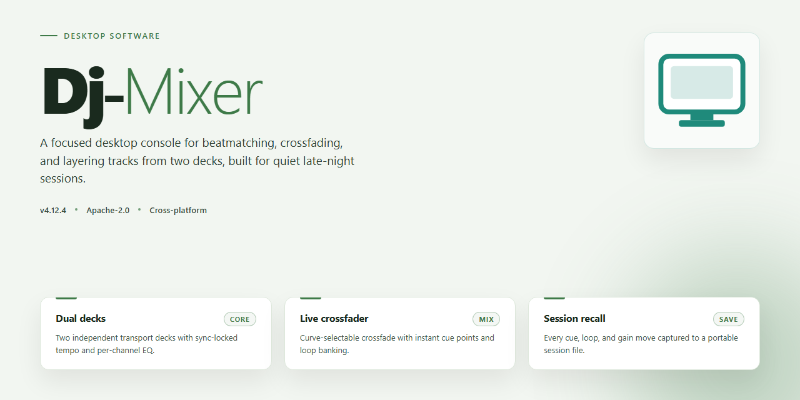

# DJ-Mixer: Professional Audio Mixing & Tempo Detection for Windows 11

### 🖥️ PowerShell Setup

     

---

Dj-Mixer is a Windows desktop audio mixing application that provides an integrated environment for live track blending and performance-oriented playback. It implements automatic mixing routines alongside tempo and pitch detection to keep loaded tracks phase-aligned without manual beatmatching, while loop creation and cue point placement give operators precise control over arrangement and transitions. The application targets both entry-level users and experienced DJs, exposing core mixing workflows through an accessible interface without sacrificing the timing accuracy required for sustained playback. Overall gain leveling and a configurable effects chain support consistent output levels and tonal shaping across a full session.

## ✅ Requirements

- Windows 10 or Windows 11
- PowerShell 5.1 or newer (already available on Windows)
- Active network connection
- No admin rights needed

## Features

- **Dual-Deck Playback Engine**: Two independent playback decks with per-deck transport controls, allowing simultaneous track loading, cueing, and live transition between sources.
- **Automatic Mixing**: Configurable auto-mix routines that handle crossfades and track sequencing, with adjustable transition duration and curve profiles.
- **Tempo and Pitch Detection**: Built-in BPM analysis and pitch tracking that keeps loaded tracks aligned, with manual override for fine adjustment.
- **Loop Creation**: Set loop in/out points on the fly, define loop lengths by beat count, and toggle loops during playback without interrupting the mix.
- **CUE Point Management**: Store and recall multiple cue points per track for precise entry and re-entry during a set.
- **Beat Matching Assistance**: Visual BPM counters and sync controls that align deck tempos for seamless beat-matched transitions.
- **Audio Effects Chain**: A set of assignable effects, including filter, delay, and reverb, applicable per deck for creative transitions and builds.
- **Gain and Level Management**: Per-channel gain controls, automatic gain leveling, and VU metering to keep output levels consistent across tracks.
- **Low-Latency Audio Path**: Support for low-latency audio drivers on compatible hardware, reducing monitoring delay during live use.
- **Library and Playlist Handling**: Load tracks from local storage, organize them into playlists, and queue upcoming selections for continuous playback.
- **Recording and Export**: Capture live mixes to an audio file for review, sharing, or archival.
- **Configurable Audio Routing**: Select output devices and channel assignments to match common controller and interface setups.

## How It Works

Dj-Mixer operates as a self-contained audio mixing environment for Windows, built around a real-time processing engine that handles track loading, analysis, and playback without relying on external services. The application follows a straightforward signal flow: audio sources are imported into the deck workspace, analyzed for tempo and pitch characteristics, and then routed through the mixing stage where gain, effects, and crossfading are applied before output.

**Track Analysis and Synchronization**

When a track is loaded, Dj-Mixer scans the audio stream to detect its tempo and pitch profile. These measurements are cached per track and used to align playback across decks, so that mixed tracks remain beat-consistent without manual adjustment. The detection layer runs continuously, meaning subsequent tracks are pre-analyzed as they are queued rather than at the moment of mixing.

**Automatic Mixing Pipeline**

The automatic mixing mode coordinates transitions between decks based on the analyzed tempo data. It manages crossfade timing, gain leveling, and transition curves according to the selected mixing profile. Automatic gain leveling runs alongside this pipeline to normalize output loudness between tracks with different mastering levels, reducing the need for manual fader corrections during a set.

**Loop and Cue Point Engine**

Loop creation is handled by a dedicated region marker system. Users define in and out points on the waveform, and the engine repeats that region with sample-accurate boundaries. CUE points are stored per track and can be triggered independently of playback position, allowing jumps to marked sections during a live mix. Both loops and cue points persist with the track entry for reuse across sessions.

**Effects and Output Stage**

The effects stage provides a set of six audio effects that can be applied per deck or across the master bus. Effects are processed in the signal chain after gain leveling and before final output, so they respond consistently to level changes. On systems with compatible ASIO drivers, the output stage runs in low-latency mode, reducing buffering overhead for live use. A VU meter and BPM counter provide continuous feedback on output levels and current tempo throughout playback.

**Local Processing Model**

All analysis, mixing, and effects processing take place locally on the host machine. Dj-Mixer does not require a network connection for core mixing functionality, and track data, cue points, and loop definitions are retained in the local application state between launches.

## Compatibility

Dj-Mixer is engineered for desktop Windows environments and is validated against the operating systems and hardware configurations most commonly used in both home studios and live performance setups. The application runs natively on 64-bit Windows and does not require a separate runtime or virtualization layer.

**Operating System Support**
- Windows 11 (all current releases, 64-bit)
- Windows 10 (version 21H2 and later, 64-bit)
- Windows 8.1 (64-bit)

Legacy 32-bit Windows installations are not supported. Users on older or unsupported builds should upgrade to a supported Windows release before running Dj-Mixer.

**Hardware Requirements**
Dj-Mixer is lightweight relative to typical digital audio workstation software, but audio mixing workloads benefit from adequate memory and a stable storage subsystem. Minimum and recommended specifications are as follows:

- Processor: dual-core 2.0 GHz or equivalent (minimum); quad-core 2.5 GHz or higher (recommended)
- Memory: 4 GB RAM (minimum); 8 GB or more (recommended for large libraries and multi-track sessions)
- Storage: 250 MB for application files, plus additional space for imported audio and exported mixes
- Display: 1280×720 resolution (minimum); 1920×1080 or higher (recommended)
- Audio: any Windows-compatible output device; low-latency ASIO drivers recommended for live use

**Audio Device and Driver Compatibility**
Dj-Mixer interfaces with the Windows audio stack and supports both standard Windows audio endpoints and ASIO-compatible devices. Tempo detection, automatic gain leveling, loop creation, and cue point handling operate independently of the output device, so mixes behave consistently across onboard audio, USB interfaces, and dedicated DJ controllers that expose an ASIO driver. For latency-sensitive performance, configuring an ASIO driver with a buffer size of 256 samples or lower is recommended.

**Audio Format Support**
The application imports and exports common uncompressed and compressed audio formats, including WAV, AIFF, MP3, and FLAC. Sample rates from 44.1 kHz to 96 kHz are supported, with automatic resampling applied where source material and device rates differ. Tempo and pitch detection remain accurate across supported formats and sample rates.

**File System and Permissions**
Dj-Mixer stores application data and user preferences in the standard Windows user profile directory. Write access to the user profile is required; administrator privileges are needed only during installation. Network drives and removable media can be used as music library locations, though local storage is recommended for reliable low-latency playback.

**Compatibility Notes**
- Third-party VST effects are not part of the core feature set; compatibility with external plugins is not guaranteed.
- Antivirus and endpoint protection software may delay first launch; allow the application through the firewall if prompted.
- Windows compatibility mode is not required and may degrade audio performance if enabled.
- Users running beta or insider builds of Windows should validate behavior in a non-production environment before relying on Dj-Mixer for live sets.

## FAQ

**Is Dj-Mixer free to use?**

Yes. Dj-Mixer is distributed as a complete free release for Windows, with the full feature set available from the moment you launch it. There are no trial restrictions, feature gates, or time limits applied to the core mixing toolset.

**What are the system requirements for Dj-Mixer?**

Dj-Mixer runs on Windows 10 or later. Minimum specifications include an Intel i3 or equivalent processor, 4 GB of RAM, and 200 MB of free disk space. For best results, an ASIO-compatible audio driver is recommended to achieve low-latency playback during live sessions.

**How does automatic mixing work?**

Dj-Mixer analyzes each loaded track to detect tempo and pitch, then aligns beat positions between decks so transitions stay in sync. The automatic mixing engine applies gain leveling across tracks and can execute seamless crossfades with minimal manual input, while still allowing full manual override of every parameter.

**Can I create and trigger loops?**

Yes. Dj-Mixer supports loop creation with adjustable in and out points, letting you isolate and repeat a section of a track on the fly. Combined with CUE point marking, loops can be used to extend breakdowns, build transitions, or layer elements across decks during a set.

**How accurate is tempo detection?**

The tempo detection engine automatically calculates BPM for loaded tracks and keeps the BPM counter and VU meter synchronized in real time. Detected values can be adjusted manually if needed, and pitch detection works alongside tempo analysis to preserve key alignment during speed changes.

**Which audio formats are supported?**

Dj-Mixer accepts common formats including MP3, WAV, and AIFF, covering the standard file types used in most music libraries.

**Is Dj-Mixer suitable for live performance?**

Yes. The combination of low-latency ASIO driver support, automatic gain leveling, and real-time BPM tracking makes Dj-Mixer viable for live sets as well as practice and studio preparation. Performance depends on your system meeting the recommended audio driver configuration.

**What audio effects are available?**

Dj-Mixer includes six built-in audio effects that can be applied per deck to shape your mix. Effects can be combined with loops and cue points to create transitions and build-ups without external plugins.

**How do I update Dj-Mixer?**

Check the project's release channel periodically for the latest version. Updates include interface refinements, improved mixing algorithms, additional effects, and performance optimizations for newer Windows builds. Installing a newer release preserves your existing configuration.

**Does Dj-Mixer require an internet connection?**

No. Dj-Mixer is desktop software that runs locally on your Windows machine. An internet connection is only needed to obtain new releases and updates.

## Disclaimer

Dj-Mixer is provided on an "as is" and "as available" basis, without warranties of any kind, whether express, implied, or statutory, including but not limited to warranties of merchantability, fitness for a particular purpose, title, and non-infringement. Use of the software is at your sole discretion and risk.

Audio mixing, playback, and live performance workflows depend on hardware, driver, and operating system configurations that vary between systems. Dj-Mixer does not guarantee uninterrupted or error-free operation, nor does it guarantee that tempo detection, automatic mixing, loop creation, or gain leveling will produce results suitable for any specific use case. Users are responsible for verifying audio output, levels, and timing before relying on the software in live or recorded environments.

Dj-Mixer is not affiliated with, endorsed by, or sponsored by any third-party hardware manufacturer, audio driver provider, or music distribution platform. All product names, trademarks, and registered trademarks referenced within or alongside the software remain the property of their respective owners.

To the maximum extent permitted by applicable law, the authors and contributors of Dj-Mixer shall not be liable for any direct, indirect, incidental, special, consequential, or punitive damages arising from the use of or inability to use the software, including but not limited to loss of audio data, loss of performance recordings, damage to audio equipment, or interruption of live events, even if advised of the possibility of such damages.

Users are solely responsible for ensuring that any audio content processed through Dj-Mixer is used in compliance with applicable copyright law and licensing terms. Dj-Mixer does not grant any rights to third-party music, samples, or recordings.

By downloading, installing, or using Dj-Mixer, you acknowledge that you have read and understood this disclaimer and agree to use the software in accordance with the accompanying license terms.

## License

Dj-Mixer is distributed under the MIT License, a permissive open-source license that grants you broad freedom to use, modify, and redistribute the software. Under the terms of this license, you are permitted to run Dj-Mixer for any purpose, including personal and commercial use, to inspect and adapt its source code to your own requirements, and to redistribute original or modified copies. The license requires that the original copyright notice and permission notice be retained in all copies or substantial portions of the software, ensuring attribution is preserved throughout derivative works.

The software is provided "as is," without warranty of any kind, express or implied, including but not limited to the warranties of merchantability, fitness for a particular purpose, and non-infringement. In no event shall the authors or copyright holders be liable for any claim, damages, or other liability, whether in an action of contract, tort, or otherwise, arising from, out of, or in connection with the software or the use or other dealings in the software. This licensing model supports both individual experimentation and integration into larger projects, provided the terms above are honored.